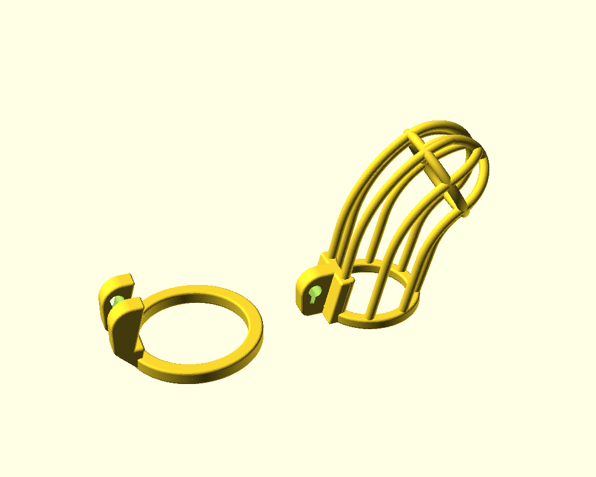
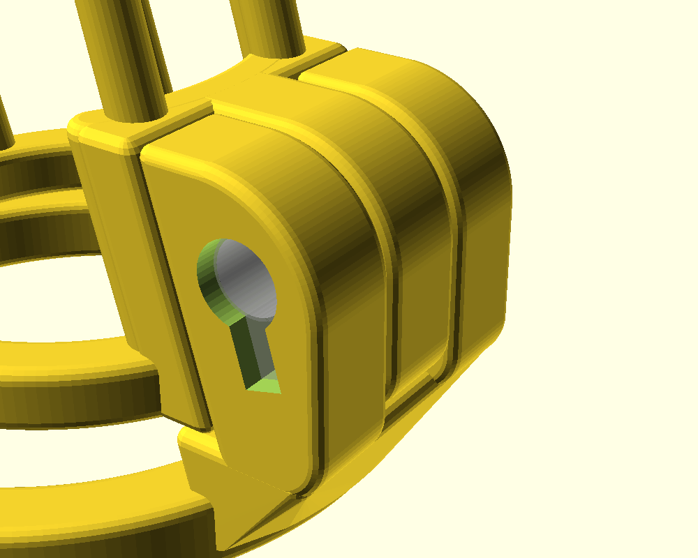
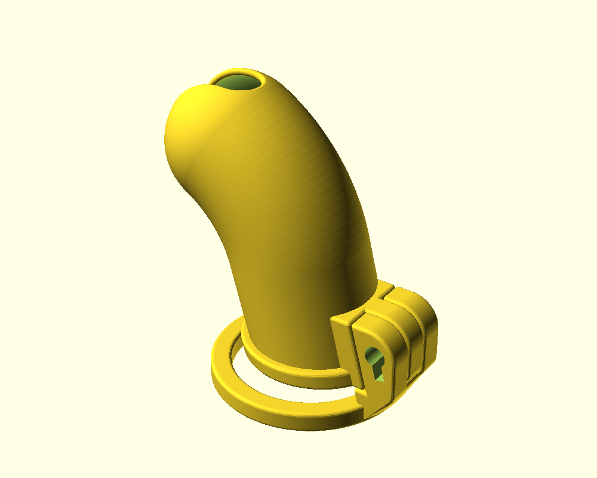
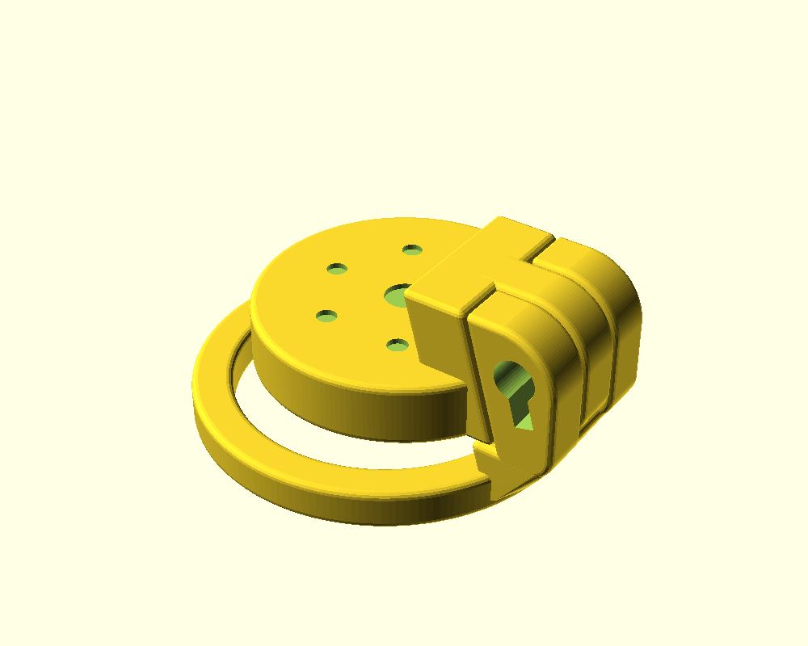
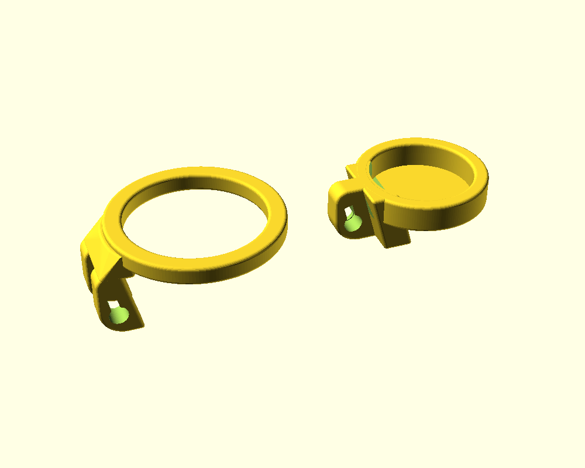

# (18+ NSFW) Parametric 3D-printable chastity cage in OpenSCAD

 This work is licensed under a <a rel="license" href="http://creativecommons.org/licenses/by-sa/3.0/">Creative Commons Attribution-ShareAlike 3.0 Unported License</a>.

This project is a fork of [heyspacebuck's parametric chastity cage](https://github.com/heyspacebuck/parametric-chastity-cage), which itself is a major overhaul of [Dani119's parametric chastity cage](https://www.thingiverse.com/thing:2764421).

The original author's notes:

> Changes from version 1: changed the opening at the tip from a hole to a slot, strengthened the area around the keyhole, changed the dovetail to a robust slot, added some options to improve printability, made it more customizable, and cleaned up the code a lot.
>
> Customize it to your own dimensions in OpenSCAD! This thing is fully parametric!
>
> **I have now removed the non-commercial clause from the CC license**. It was present on the original cage that I remixed from; but now the code is so completely distinct that I feel I can properly claim it as my own and license it as I see fit.

## Features

- **Selectable lock mechanisms (`lock_type`).** Support for both the Holy - Trainer - style stealth lock (`stealth_lock.scad`) with temporary latching via `play-pin.stl`, and the small cylinder cam lock modelled in Fusion 360 (`fusion_lock.scad`).
- **Solid wall option (`solid_wall`).** Replace the cage bars with a solid contoured wall along the same path, including a rounded front slit lip and configurable slit span (`slit_start` and `slit_end`).
- **Flat top cap (`flat_top`).** Build a flat cap instead of the barred cage: a wall ring closed by a flat plate with ventilation holes.
- **Bridge layer (`flat_bridge_layer`).** An optional thin sacrificial layer under the flat plate lets slicers bridge the ceiling cleanly in one continuous pass.
- **Printable base rings (`base_ring_roundness`).** The base ring and cage ring can have square or rounded - square cross - sections for easy bed adhesion and support - free printing.
- **Base ring flattening factor (`base_ring_flatten_factor`).** Scale the base ring along the Z axis for customized anatomical fit.
- **Refined geometry and printability.** Rounded ends on slit bars, improved lock body fillets, reinforced outer dovetail bridge, and tuned defaults for fit and printability.
- **Smoother curves.** Resolution adapts via `$fa` and `$fs`, keeping large curves smooth and preview operations fast, with Makefile `-DFN` override support.
- **Customizer tabs.** Parameters are cleanly organized into OpenSCAD Customizer tabs in `snake_case`, while maintaining full backward compatibility with legacy presets (`separateParts`, `wavyBase`, `waveAngle`).

## Usage

1. Open `main.scad` in [OpenSCAD](https://openscad.org/). A recent development snapshot with the **Manifold** backend enabled (Preferences → Advanced → Backend) is strongly recommended; full CSG renders then complete in seconds.
2. Open the Customizer (Window → Customizer) and configure your dimensions.
3. Render (F6) and export the STL. Set `separate_parts = 1` to lay out the cage and base ring side - by - side for printing.
4. Alternatively, build STLs directly from the terminal using the provided `Makefile` via `make`.

Preview (F5) is deliberately optimized to remain fast and responsive.

## Lock Mechanisms

The model supports two locking options configured via `lock_type`:

### 1. Stealth Lock (`lock_type = 0`, Default)

Uses the Holy - Trainer - style cylinder and rotating cam cavity defined in `stealth_lock.scad`. It features updated 3.5 mm cylinder clearance and 120° cam sweep for reliable latching. A printable pin (`play-pin.stl`) is included for temporary retention without inserting a metal lock core.

### 2. Fusion 360 Lock (`lock_type = 1`)

The lock case is cut for a small cylinder lock (see `fusion_lock.scad` for full dimensional details):

| Part | Shape |
|---|---|
| Shell | Ø6 mm cylinder, 12.8 mm long, with a 2.7 mm fin 7 mm below the axis |
| Core | Ø5.5 mm cylinder, extending 5.8 mm past the shell, with a 1.7 mm cam at the far end |

The key enters from the shell end. The lock slides in cam - first from the key side. Turning the key 45° clockwise swings the cam into a closed pocket within the base part, securing the assembly. The pocket resides entirely inside one part, preventing the cam from binding across the sliding dovetail joint.

- `lock_margin` provides clearance around the lock and the cam pocket.
- `lock_key_depth` sets the recess depth of the key face below the case surface.
- `lock_clockwise` sets the turning direction (default 1 = clockwise swings toward the reinforced cage side).
- `show_lock` renders the lock model in place for preview (0 = hidden, 1 = unlocked, 2 = locked).

## Solid Wall

With `solid_wall = 1`, the bars and glans cap are replaced by a solid contoured wall along the same trajectory: straight segment, bend, and domed tip. The front slit (`slit_width`) features rounded ends and a smooth lip. `slit_start` and `slit_end` specify the angular span across the dome (90° = tip, 180° = base on the far side). The inner boundary maintains `cage_diameter`, with material extending outward by `solid_wall_thickness`.

The cage ring and lock block interface smoothly with the wall, maintaining a flush internal surface with no inward protrusions.

## Flat Top

With `flat_top = 1`, the cage is replaced with a low - profile flat cap. The cage ring extends upward into a cylindrical wall (`flat_wall_height`) sealed by a flat top plate containing a central hole and surrounding ventilation holes.

When printed ring - down, the top plate functions as a wide bridge. With `flat_bridge_layer = 1` (default), the holes pause short of the bottom face by `flat_bridge_layer_thickness` (0.2 mm), enabling the slicer to bridge the entire ceiling in one continuous pass. The thin membranes are easily pushed through after printing.

## Base Rings

- `base_ring_roundness` configures the cross - section of the flat base ring and the cage ring, from 0 (square, easiest to print support - free) to 1 (fully round circular torus). The corner radius equals `base_ring_roundness × base_ring_thickness / 2`. The default (0.33) matches the 0.99 mm edge rounding of the lock block.
- `base_ring_flatten_factor` applies vertical scaling along the Z axis to fine - tune ring ovality and comfort.
- The wavy base ring option (`wavy_base = 1`) provides an ergonomic contoured profile; it remains round in cross - section.

## Customizer Parameters

| Tab | Parameters | Description |
|---|---|---|
| General | `separate_parts`, `flat_top`, `cage_diameter`, `tilt`, `gap` | Core layout, cap style, and general positioning |
| Cage | `penis_length`, `cage_bar_thickness`, `cage_bar_count`, `solid_wall`, `solid_wall_thickness`, `slit_width`, `slit_start`, `slit_end`, `bend_point_x`, `bend_point_z` | Bar geometry, solid wall options, and curvature bend |
| Flat top | `flat_wall_height`, `flat_plate_thickness`, `flat_center_hole`, `flat_hole_count`, `flat_hole_diameter`, `flat_hole_radius`, `flat_bridge_layer`, `flat_bridge_layer_thickness` | Flat cap dimensions, hole pattern, and bridging layer |
| Base ring | `base_ring_diameter`, `base_ring_thickness`, `base_ring_flatten_factor`, `base_ring_roundness`, `wavy_base`, `wave_angle` | Base ring diameter, thickness, roundness, flattening factor, and wave contour |
| Lock | `lock_type`, `lock_key_depth`, `lock_clockwise`, `show_lock` | Choice of stealth or Fusion 360 lock, orientation, and preview |
| Clearances | `lock_margin`, `part_margin` | Fit tolerances for lock cavity and sliding dovetail joints |

Legacy parameter names (`separateParts`, `wavyBase`, `waveAngle`) continue to be supported as backward - compatible fallbacks.

## Files

| File | Contents |
|---|---|
| `main.scad` | The primary parametric cage model with full Customizer support |
| `fusion_lock.scad` | Dimensions, cavity cutter, and preview model for the Fusion 360 lock |
| `stealth_lock.scad` | The Holy - Trainer - style stealth lock module |
| `play-pin.stl` | 3D - printable play pin for temporary latching with the stealth lock |
| `torus.scad` | Torus utilities, including rectangular and square - section profile extrusions |
| `handyfunctions.scad`, `vec3math.scad` | Vector math helpers and transformation shortcuts |
| `Makefile` | Build automation for rendering previews and compiling STL models |

Feedback, suggestions, and remixes are more than welcome!
